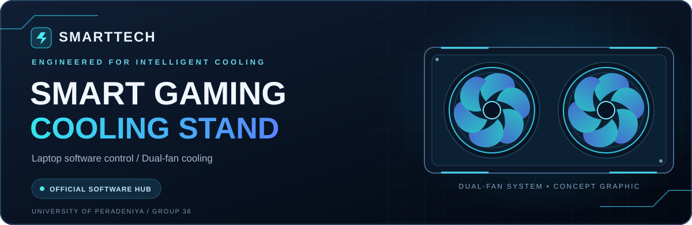

<p align="center">
  
</p>

<h1 align="center">SmartCoolingStand</h1>
<p align="center"><b>Intelligent cooling. Software-controlled performance.</b></p>
<p align="center">Official software distribution and documentation hub</p>

<p align="center">
  
  
  
  
</p>
<p align="center">
  <a href="https://github.com/malishadisanayaka30-design/SmartCoolingStand/releases/download/v1.0.0/SmartCoolingStand_Setup_v1.0.0.exe"></a>
  <a href="https://falling-mode-1455.e21311.workers.dev/"></a>
  <a href="https://github.com/malishadisanayaka30-design/SmartCoolingStand/releases"></a>
</p>

---

## ⚡ About SmartTech

The **Smart Gaming Laptop Cooling Stand** is a university engineering project that combines a dual-fan cooling system, ESP32-based control and a Windows desktop application. The stand is designed to offer automatic and manual fan control from the laptop.

| 🌡️ Automatic control | 🎛️ Manual control | 🖥️ Desktop software |
| :--- | :--- | :--- |
| Cooling based on laptop temperature data | User-controlled fan speed | Manage cooling through the dedicated Windows application |

## 📦 Software center

**SmartCoolingStand v1.0.0** · Windows installer

Download the installer and consult the included system requirements before installation.

| Resource | Description | Access |
| :--- | :--- | :--- |
| Windows installer | Official setup application | [Download EXE](https://github.com/malishadisanayaka30-design/SmartCoolingStand/releases/download/v1.0.0/SmartCoolingStand_Setup_v1.0.0.exe) |
| Quick Start Guide | Software setup and first use | [Download PDF](https://github.com/malishadisanayaka30-design/SmartCoolingStand/releases/download/v1.0.0/QuickStartGuide.pdf) |
| Release notes | Version information | [Download](https://github.com/malishadisanayaka30-design/SmartCoolingStand/releases/download/v1.0.0/ReleaseNotes.txt) |
| System requirements | Supported system information | [Download](https://github.com/malishadisanayaka30-design/SmartCoolingStand/releases/download/v1.0.0/SystemRequirements.txt) |
| SHA-256 checksums | File integrity verification | [Download](https://github.com/malishadisanayaka30-design/SmartCoolingStand/releases/download/v1.0.0/SHA256SUMS.txt) |
| Third-party notices | Dependency and license notices | [Download](https://github.com/malishadisanayaka30-design/SmartCoolingStand/releases/download/v1.0.0/ThirdPartyNotices.txt) |

## 🚀 Getting started

1. Review the system requirements and quick-start guide.
2. Download the official Windows installer from the release page.
3. Follow the installation and connection instructions in the guide.
4. Launch SmartCoolingStand and select your cooling mode as instructed.

## 🛡️ Verify your download

Compare the installer SHA-256 hash with the value in the corresponding release's checksum file. From PowerShell, in the installer directory:

```powershell
Get-FileHash .\SmartCoolingStand_Setup_v1.0.0.exe -Algorithm SHA256
```

A matching hash verifies file integrity against the published checksum; it is not a security certification.

## 📖 Product documentation & support

For the full user manual, product information, team information and support, visit the [SmartTech product website](https://falling-mode-1455.e21311.workers.dev/).

**Email:** [smarttechcoolingstand@gmail.com](mailto:smarttechcoolingstand@gmail.com)

## 🎓 Developed by

**Group 36** · Faculty of Engineering · University of Peradeniya, Sri Lanka

This repository is intended for software distribution and documentation. The original application source code is not included.

---
<p align="center"><b>SMARTTECH</b><br/>Engineering smarter cooling solutions.</p>
